# Lab6Web
# LAPORAN PRAKTIKUM 6
## JavaScript DOM dan Event Handling
---

## 1. Tujuan Praktikum

1. Memahami konsep DOM (Document Object Model) pada JavaScript.
2. Memahami penggunaan Event Handling untuk menangani tindakan pengguna.
3. Mengubah isi dan tampilan elemen HTML menggunakan JavaScript.
4. Memahami penggunaan `addEventListener()`, `classList`, dan `createElement()`.
5. Membuat validasi form menggunakan JavaScript.
6. Menerapkan JavaScript dalam pembuatan aplikasi sederhana.

---

# E. Langkah Kerja Praktikum

### Latihan 1 — Mengubah teks dengan DOM

**Tujuan:**

Memahami cara mengambil dan mengubah isi elemen HTML menggunakan JavaScript.

**Langkah Kerja:**
1. Membuat elemen HTML berupa judul dan paragraf.
2. Memberikan ID pada setiap elemen.
3. Mengambil elemen menggunakan `document.getElementById()`.
4. Mengubah isi elemen menggunakan `textContent`.

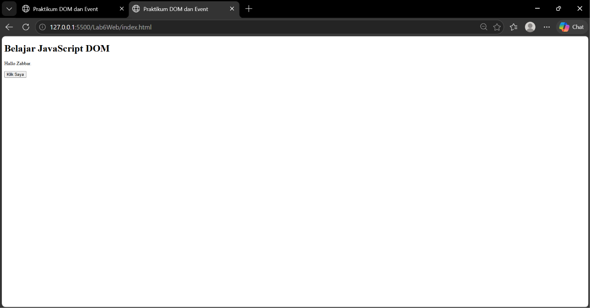

Teks judul dan paragraf berhasil diubah menggunakan JavaScript.

### Latihan 2 — Event click

**Langkah Kerja:**
1. Membuat tombol pada HTML.
2. Mengambil elemen tombol menggunakan JavaScript.
3. Menggunakan `addEventListener("click")`.
4. Menampilkan waktu ketika tombol ditekan.

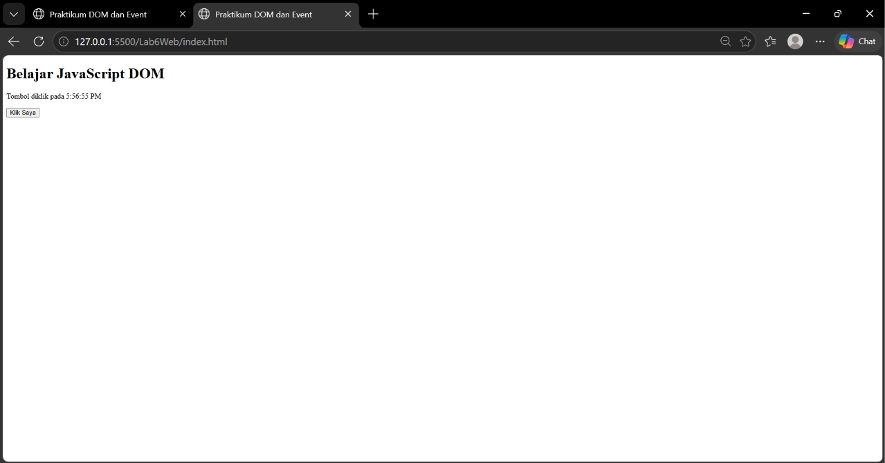

Ketika tombol diklik, paragraf menampilkan waktu saat tombol ditekan.

### Latihan 3 — Mengubah kelas dan gaya CSS

**Tujuan:**

Memahami cara mengubah tampilan elemen HTML menggunakan `classList.toggle()`.

**Langkah Kerja:**
1. Membuat paragraf dan tombol pada HTML.
2. Membuat class CSS bernama `highlight` dan `teks-besar`.
3. Menggunakan JavaScript untuk mengaktifkan dan menonaktifkan class.
4. Menguji perubahan tampilan dengan menekan tombol.

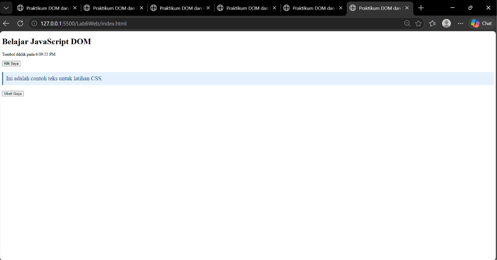

Tampilan teks berhasil berubah ketika tombol diklik.

### Latihan 4 — Event input dan penghitung karakter

**Tujuan:**

Menampilkan jumlah karakter yang dimasukkan pengguna secara langsung.

**Langkah Kerja:**
1. Membuat input nama.
2. Membatasi input maksimal 40 karakter.
3. Mengambil nilai input menggunakan JavaScript.
4. Menggunakan event `input` untuk menghitung jumlah karakter.

Uji dengan mengetik, menghapus, dan menempelkan teks.

Mengetik
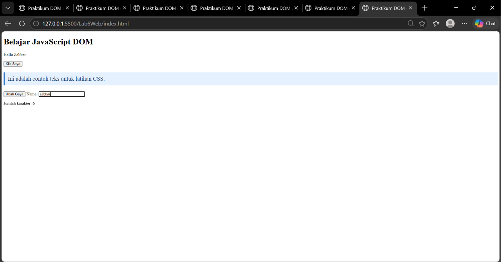

Menghapus
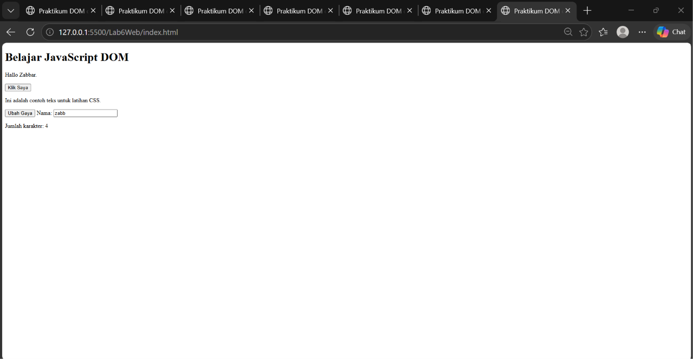

Menempelkan teks
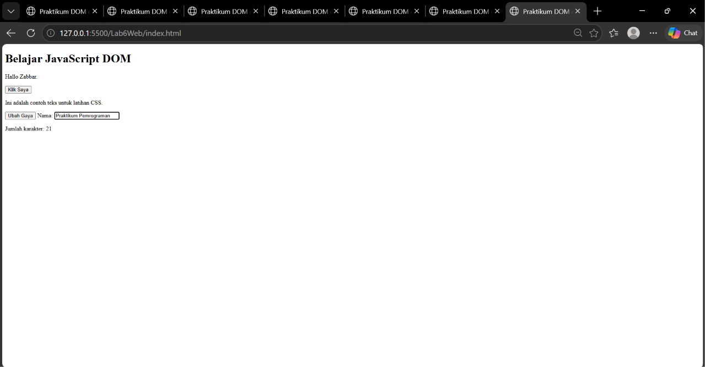

Jumlah karakter bertambah atau berkurang secara otomatis ketika pengguna mengetik atau menghapus teks.

### Latihan 5 — Validasi form pendaftaran

**Tujuan:**

Memahami cara melakukan validasi data yang dimasukkan pengguna.

**Langkah Kerja:**
1. Membuat form yang berisi nama, email, dan usia.
2. Mengambil nilai setiap input.
3. Memeriksa apakah nama sudah diisi.
4. Memeriksa format email.
5. Memastikan usia berupa bilangan bulat antara 17 sampai 100.
6. Menggunakan `preventDefault()` agar form tidak langsung dikirim.

Uji minimal lima kondisi: semua kosong, nama kosong, email tidak valid, usia di bawah 17, dan semua input
valid.

Semua kosong
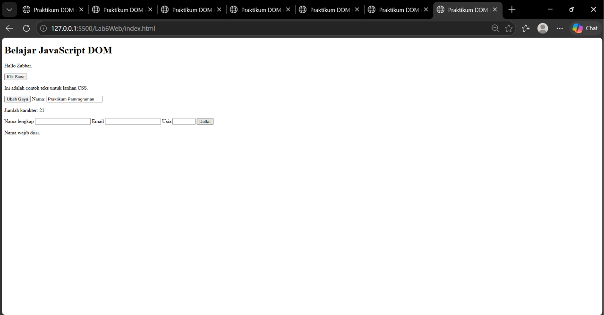

Nama kosong
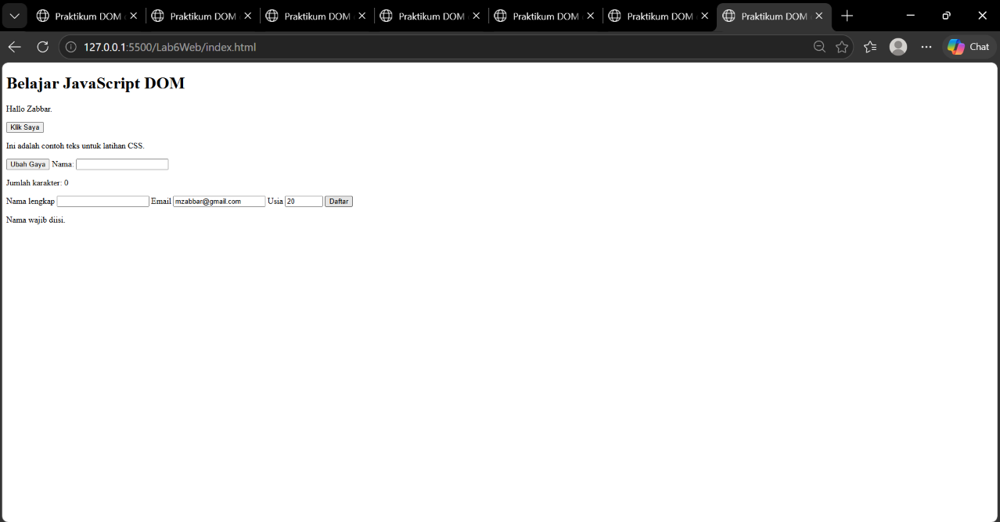

Email tidal valid
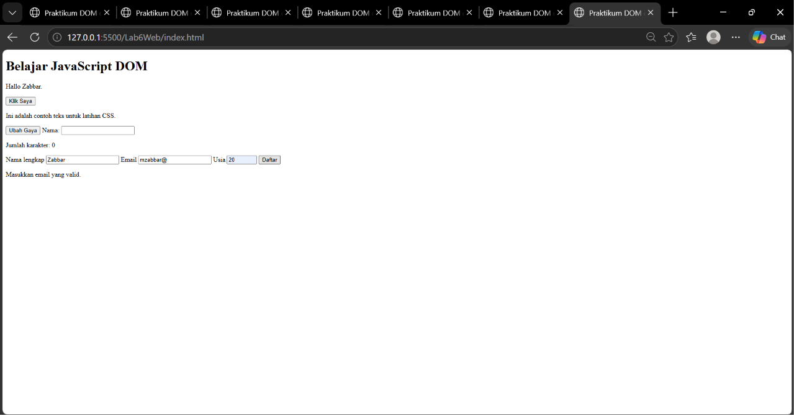

Usia di bawah 17
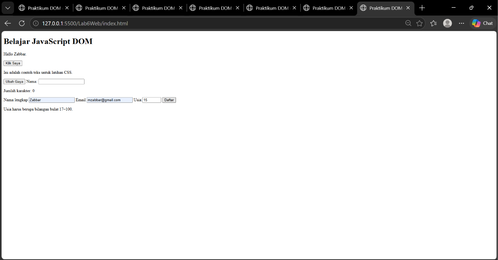

Semua input valid.
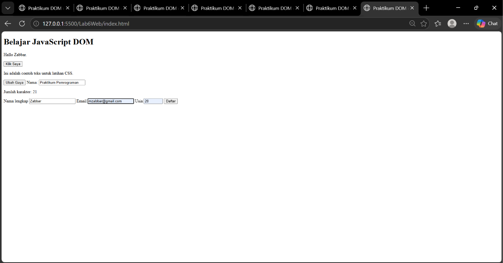
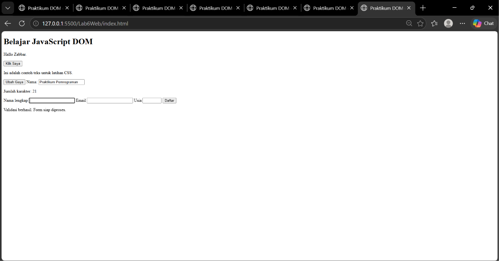

Program berhasil menampilkan pesan kesalahan apabila data tidak sesuai dan pesan berhasil apabila semua data valid.

### Latihan 6 — Daftar tugas sederhana (To-do List)

**Tujuan:**

Membuat daftar tugas sederhana menggunakan JavaScript DOM.

**Langkah Kerja:**
1. Membuat input untuk memasukkan tugas.
2. Membuat tombol tambah tugas.
3. Menggunakan `createElement()` untuk membuat elemen daftar.
4. Menggunakan `appendChild()` untuk menambahkan tugas.
5. Menggunakan `classList.toggle()` untuk menandai tugas selesai.

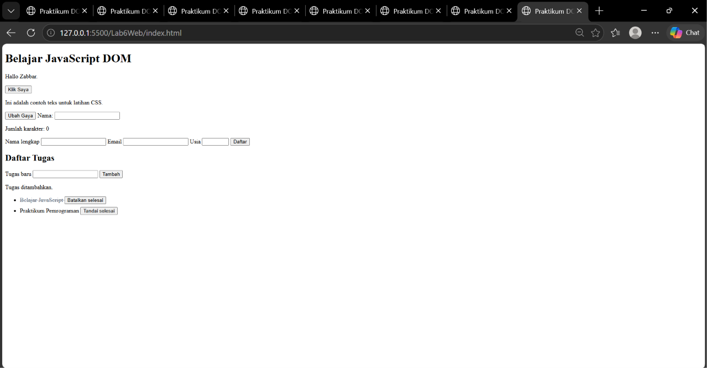
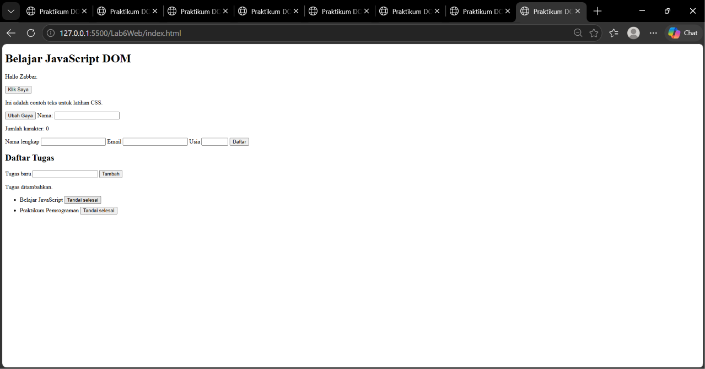

Pengguna dapat menambahkan tugas dan menandai tugas yang sudah selesai.

---

# F. Mini Project — Form Pendaftaran Workshop

### Tujuan

Membuat aplikasi form pendaftaran workshop sederhana dengan menerapkan DOM, Event Handling, validasi input, dan manipulasi teks.

### Langkah Kerja

1. Membuat file HTML sebagai struktur halaman.
2. Membuat file CSS untuk mengatur tampilan form.
3. Membuat file JavaScript untuk menjalankan fungsi program.
4. Membuat input nama lengkap dan email.
5. Membuat pilihan sesi workshop.
6. Membuat penghitung jumlah karakter nama.
7. Menampilkan sesi yang dipilih pengguna.
8. Membuat validasi nama, email, dan pilihan sesi.
9. Menampilkan pesan berhasil atau pesan kesalahan.
10. Membuat tombol reset untuk mengosongkan form.

### Fitur Program

- Input nama lengkap.
- Input email.
- Pilihan sesi pagi, siang, dan malam.
- Penghitung jumlah karakter nama.
- Informasi sesi yang dipilih.
- Validasi data pendaftaran.
- Pesan keberhasilan dan kesalahan.
- Ringkasan data pendaftaran.
- Tombol reset.
- Tampilan responsif untuk desktop dan perangkat mobile.

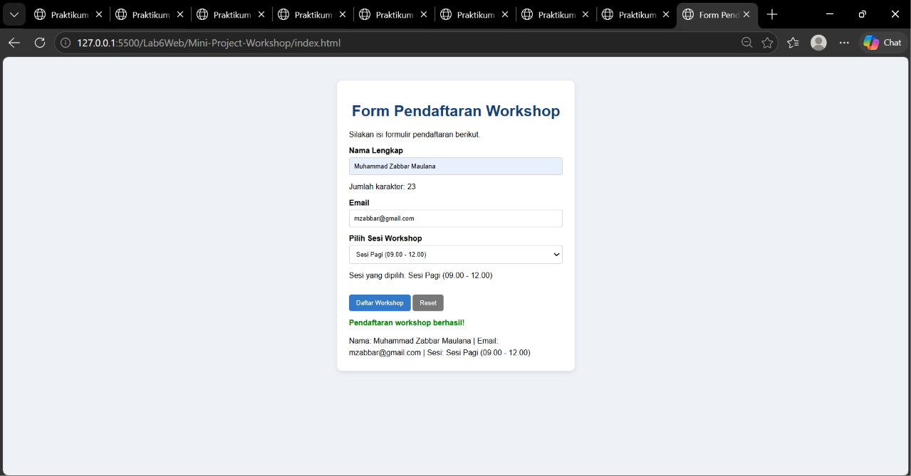
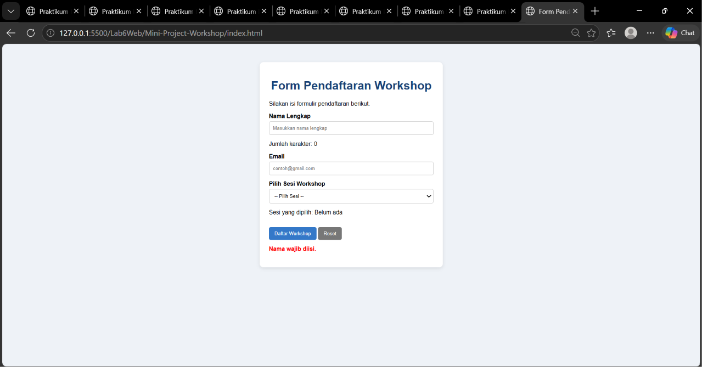
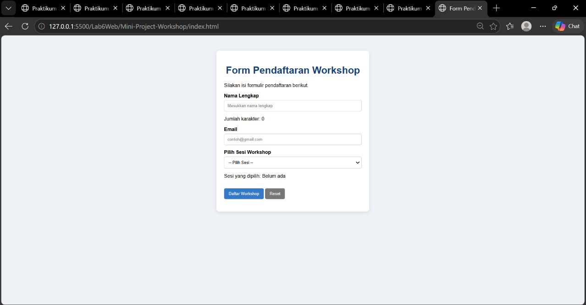

Form pendaftaran workshop berhasil dibuat. Program dapat memeriksa kelengkapan nama, format email, dan pilihan sesi. Apabila data sudah sesuai, program menampilkan pesan pendaftaran berhasil beserta ringkasan data pengguna.

---

# G. Eksperimen Mandiri

### 1.Tambahkan tombol untuk menghapus satu item dari To-do List..

**Langkah Kerja:**
1. Membuat beberapa daftar tugas.
2. Menambahkan tombol hapus pada setiap tugas.
3. Menggunakan event `click`.
4. Menggunakan `remove()` untuk menghapus elemen tugas.

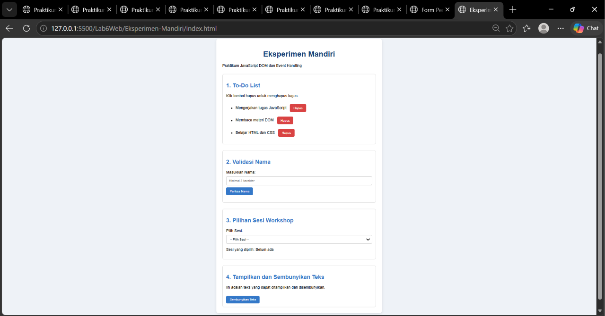

Tugas dapat dihapus satu per satu dengan menekan tombol hapus.

### 2.Ubah validasi agar nama minimal terdiri dari tiga karakter.

**Langkah Kerja:**
1. Membuat input nama.
2. Membuat tombol pemeriksaan nama.
3. Mengambil nilai input menggunakan JavaScript.
4. Memeriksa panjang karakter menggunakan `length`.
5. Menampilkan pesan sesuai hasil pemeriksaan.

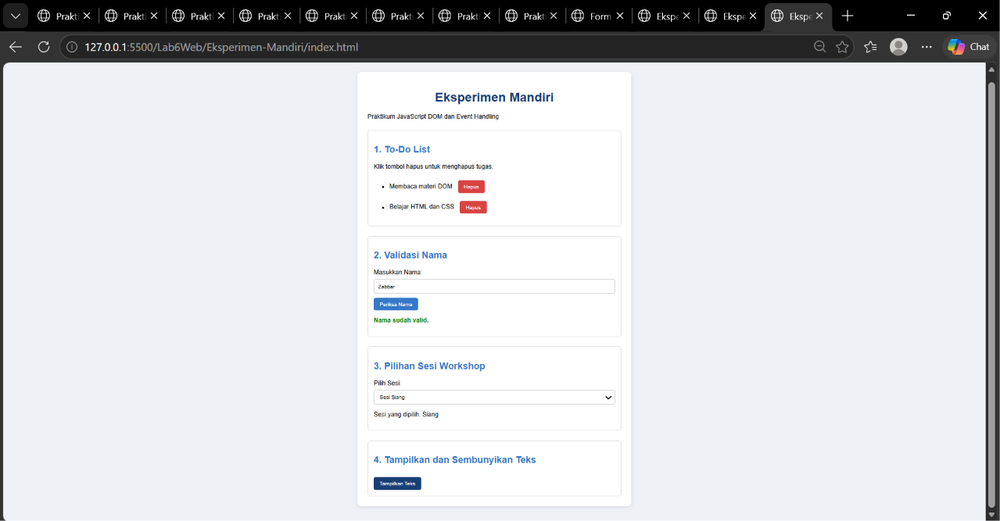

Nama yang memiliki kurang dari tiga karakter akan mendapatkan pesan kesalahan. Nama dengan minimal tiga karakter dinyatakan valid.

### 3.Tambahkan event change pada dropdown sesi workshop dan tampilkan sesi yang dipilih.

**Langkah Kerja:**
1. Membuat pilihan sesi workshop.
2. Mengambil elemen select menggunakan JavaScript.
3. Menggunakan `addEventListener("change")`.
4. Menampilkan sesi yang dipilih pengguna.

Program dapat menampilkan informasi sesi sesuai pilihan pengguna.

### 4. Buat tombol untuk menyembunyikan dan menampilkan paragraf menggunakan class CSS.

**Langkah Kerja:**
1. Membuat paragraf dan tombol.
2. Membuat class CSS `sembunyi`.
3. Menggunakan `classList.toggle()` untuk mengubah tampilan teks.
4. Mengubah tulisan tombol sesuai kondisi teks.

Teks dapat disembunyikan dan ditampilkan kembali dengan menekan tombol.

### 5. Coba pindahkan script tanpa defer ke bagian head. Amati kemungkinan masalah dan jelaskan penyebabnya.

**Langkah Kerja:**
1. Menggunakan script dengan atribut `defer`.
2. Menghapus atribut `defer`.
3. Menjalankan halaman dan mengamati hasilnya.
4. Membandingkan perilaku JavaScript sebelum dan sesudah atribut dihapus.
5. Mengembalikan atribut `defer` setelah percobaan.

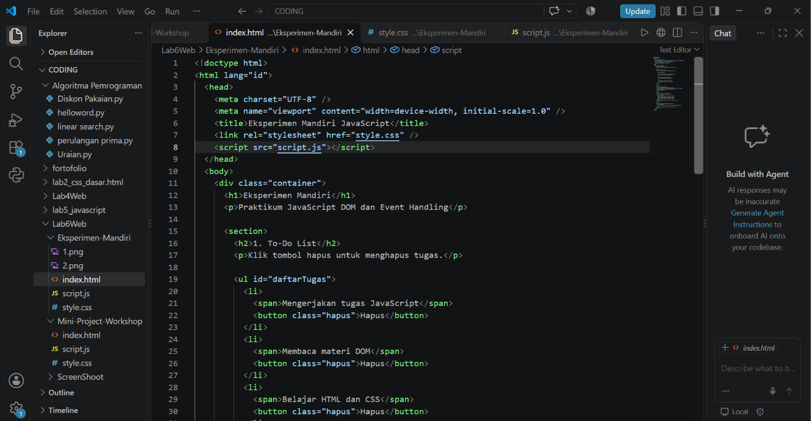
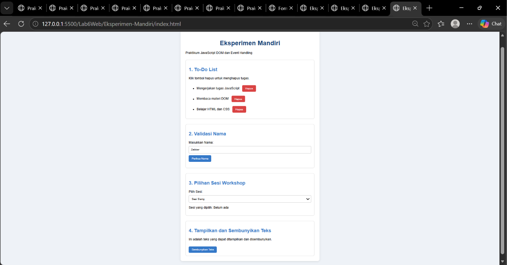

Penjelasan:
Tanpa atribut `defer`, JavaScript dapat dijalankan sebelum elemen HTML selesai diproses. Hal tersebut dapat menyebabkan elemen yang dicari belum tersedia. Dengan atribut `defer`, JavaScript dijalankan setelah HTML selesai diproses.

---
